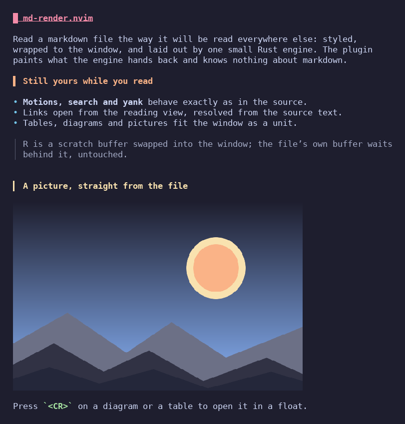
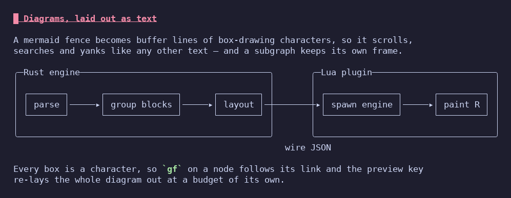
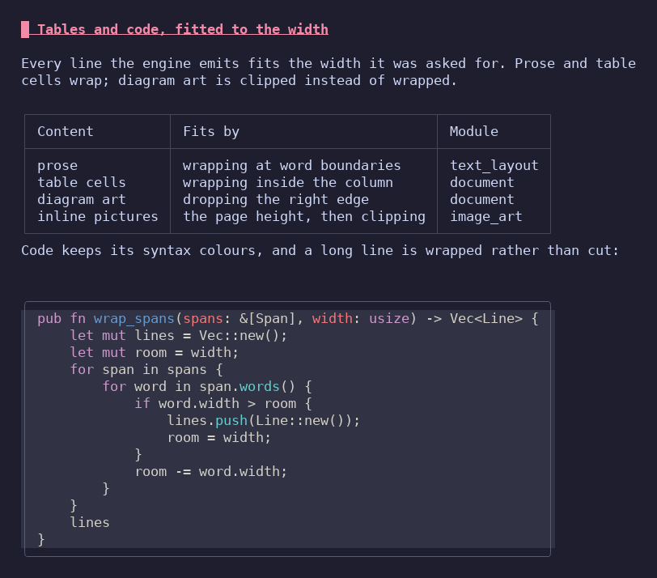
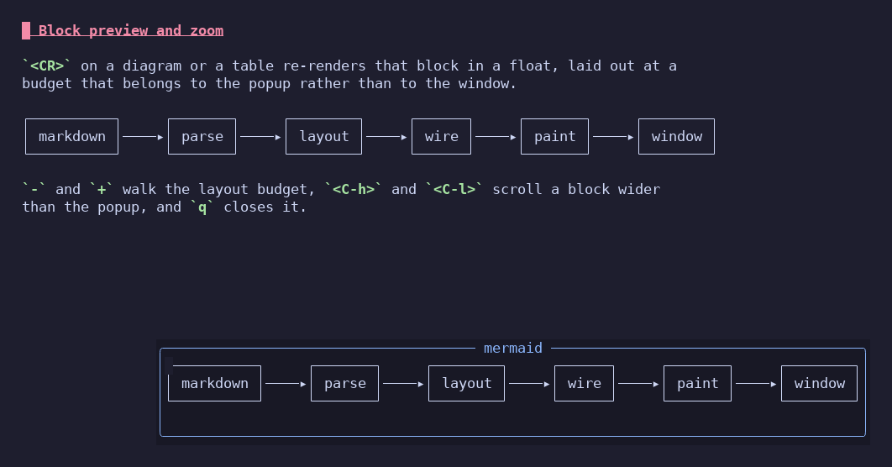

# markdown-rs.nvim

[](https://github.com/Moler1995/markdown-rs.nvim/actions/workflows/ci.yml)
[](https://github.com/Moler1995/markdown-rs.nvim/releases)
[](LICENSE)

Read markdown as it was meant to look, inside Neovim, with one key back to the
source. Headings, tables, mermaid diagrams, images and highlighted code are laid
out for the window's width by a small Rust engine; the plugin paints the result
into a read-only buffer in the same window and toggles back to the file's own
buffer.

```text
 Rendered view                              Source
 ─────────────────────────────────────      ─────────────────────────────────
 # Release notes                            # Release notes

 ## Highlights                              ## Highlights

   *  Faster startup                        - Faster startup
   *  Static engine builds                  - Static engine builds

 ┌───────────┬───────────┐                  | Target  | Archive  |
 │ Target    │ Archive   │                  | ------- | -------- |
 ├───────────┼───────────┤                  | Linux   | tar.gz   |
 │ Linux     │ tar.gz    │                  | Windows | zip      |
 └───────────┴───────────┘                  | macOS   | tar.gz   |

 <leader>mr toggles                          the same file, editable
```

## What it looks like

Headings, lists, quotes and inline code, wrapped to the window. The picture is
the file itself, drawn by the terminal where one can draw it:



Mermaid diagrams are laid out as text, subgraph frames and all, so they scroll,
search and yank like any other line:



Tables and code blocks are fitted to the width, and code keeps its syntax
colours:



`<CR>` on a diagram opens it in a float, laid out at a budget of its own:



## Features

- **A rendered view in the window.** Every normal-mode motion, search and yank
  works in it. The source buffer is never modified; the toggle puts it back.
- **Links that work from the reading view.** `gf` follows files, URLs and
  anchors, reads the source text, tells apart several links on one line, and
  follows mermaid `click` directives.
- **Block preview and zoom.** `<CR>` on a table or diagram re-renders that
  block at a budget of its own, so none of a clipped diagram is unreachable.
- **Image artwork.** PNG, JPEG, GIF, WebP, BMP, TIFF and ICO are drawn as
  character cells, in braille or ASCII, with animation stepping on demand.
- **Native-resolution images in the preview.** On Neovim 0.12 in WezTerm,
  iTerm2, kitty or Ghostty, `<CR>` on an image has the terminal draw the file
  itself over the popup — including animated GIFs playing at their own speed in
  WezTerm and iTerm2. `graphics = 'off'` keeps the character artwork.
- **Themes and per-window state.** The engine's palette follows `theme`; two
  windows on one file keep their own rendered buffers.
- **Diagnostics.** `:checkhealth md-render` names the engine, the resolution
  step, the wire version and anything that needs attention.

## Requirements

- **Neovim 0.10 or newer.**
- **The `md-render` engine binary.** Download a release or build it from a
  checkout; the plugin does not fetch or build anything at startup.
- **A truecolor terminal** for braille image artwork (`'termguicolors'`).
  Without it images use the ASCII encoding; everything else is unchanged.
- **Neovim 0.12 or newer** for the terminal to draw the image file itself in
  the preview popup. Optional: older versions keep the character artwork.
- **Rust 1.92 or newer** only for a source build.

### Compatibility

The plugin CI runs the suites on Neovim v0.10.4 and stable. The release
workflow publishes one engine archive per target:

| Platform | Target | Archive |
| --- | --- | --- |
| Linux | `x86_64-unknown-linux-musl` | `md-render-vX.Y.Z-x86_64-unknown-linux-musl.tar.gz` |
| Windows | `x86_64-pc-windows-msvc` | `md-render-vX.Y.Z-x86_64-pc-windows-msvc.zip` |
| macOS | universal, Intel and Apple silicon | `md-render-vX.Y.Z-universal-apple-darwin.tar.gz` |

Each release also ships `SHA256SUMS`. The plugin and the engine share a wire
format version; a mismatch is reported instead of rendering.

## Installation

Two pieces: the plugin, and the engine binary the plugin spawns.

### 1. The plugin

lazy.nvim:

```lua
{
  'Moler1995/markdown-rs.nvim',
  event = { 'BufReadPre *.md', 'BufNewFile *.md' },
  -- Optional: build the engine into the plugin's bin/ on install. Works
  -- wherever Rust does; skip it and download a release instead.
  build = function()
    local built = vim.system({ 'cargo', 'build', '--release', '-p', 'md-render' }):wait()
    if built.code ~= 0 then
      error('md-render: cargo build failed: ' .. (built.stderr or ''))
    end
    local name = vim.fn.has('win32') == 1 and 'md-render.exe' or 'md-render'
    vim.fn.mkdir('bin', 'p')
    vim.uv.fs_copyfile('target/release/' .. name, 'bin/' .. name)
  end,
  config = function()
    require('md-render').setup({})
  end,
}
```

vim.pack:

```lua
vim.pack.add({ 'https://github.com/Moler1995/markdown-rs.nvim' })
require('md-render').setup({})
```

mini.deps:

```lua
MiniDeps.add({ source = 'Moler1995/markdown-rs.nvim' })
require('md-render').setup({})
```

Loading from `FileType` is supported: the buffer that triggered the load is
attached and rendered without reopening it.

### 2. The engine

**Download a release.** Unpack the archive for your platform and put the
binary at:

```text
<stdpath('data')>/md-render/md-render        POSIX
<stdpath('data')>/md-render/md-render.exe    Windows
```

`stdpath('data')` is `~/.local/share/nvim` on Linux and macOS and
`~/AppData/Local/nvim-data` on Windows.

**Or build from a checkout.** POSIX:

```bash
cargo build --release -p md-render
mkdir -p bin
cp target/release/md-render bin/md-render
```

PowerShell:

```powershell
cargo build --release -p md-render
New-Item -ItemType Directory -Force bin | Out-Null
Copy-Item target/release/md-render.exe bin/md-render.exe
```

A plugin loaded from the checkout finds `bin/`; an installed plugin falls
through to the data directory. The full search order is: the `engine` option,
then `md-render` on `PATH`, then `<plugin-root>/bin/`, then
`<stdpath('data')>/md-render/`. A configured `engine` that cannot run is
reported rather than silently skipped. See `docs/porting.md` for the release
layout and the wire-version check.

## Quick start

1. Install the plugin and put the engine where it can be found.
2. Open a markdown file: `nvim README.md`.
3. The file opens rendered. Press `<leader>mr` to see the source, and again to
   return.
4. Run `:checkhealth md-render` if anything stays unrendered.
5. `:help md-render` is the complete reference.

## Configuration

`setup()` is optional; the defaults work. Every field is optional and the merge
is deep:

```lua
require('md-render').setup({
  theme = 'nord',
  image_mode = 'auto',
  image_inline = 'auto',
  graphics = 'auto',
  keymaps = {
    toggle = '<leader>mr',
    write = '<C-s>',
    preview = '<CR>',
    follow = 'gf',
    follow_tab = 'gF',
    open_image = 'gx',
    frame_next = '<C-n>',
    pause = '<Space>',
    zoom_in = '+',
    zoom_out = '-',
    scroll_left = '<C-h>',
    scroll_right = '<C-l>',
  },
  preview = {                   -- the popup's caps, as fractions of the editor
    max_width_pct = 0.9,
    max_height_pct = 0.9,
  },
  resize_debounce = 100,        -- coalesce resizes and edits before re-rendering
  settle_debounce = 15,         -- coalesce scrolls before an inline picture is painted again
})
```

`theme` is passed to the engine. `image_mode` picks how artwork is drawn,
`image_inline` whether an inline image is a three-row card, a card with the
picture painted over it, or that artwork, and `graphics` whether the terminal
draws image files itself. `filetypes` decides which buffers the plugin manages.
Every keymap may be set to `false` to leave that key alone.

The full option reference — every key, its type, default and meaning — is
`:help md-render-options`. The plugin ships its own help file, so the reference
and the code cannot drift apart.

## Commands and keymaps

| Command | Does |
| --- | --- |
| `:MdRenderToggle` | swap between the rendered view and the source |
| `:MdRenderShow` | show the rendered view |
| `:MdRenderSource` | show the source |
| `:MdRenderReset` | forget cached renders and highlight groups |

<!-- keymaps -->

| Key | Where | Does |
| --- | --- | --- |
| `<leader>mr` | R and S | swap between the rendered view and the source |
| `<C-s>` | R and S | write the source buffer |
| `gf` | R and S | follow the link under the cursor |
| `gF` | R and S | follow the link under the cursor in a new tab |
| `gx` | R only | open the image under the cursor with the system application |
| `<C-n>` | R and the animation popup | show the next frame of the animated image under the cursor; step one frame in the popup while paused |
| `<CR>` | R only | preview the block or image under the cursor, or close the preview |
| `i` | R only | cross to S and insert before the cursor |
| `a` | R only | cross to S and insert after the cursor |
| `I` | R only | cross to S and insert at the first non-blank |
| `A` | R only | cross to S and insert at the end of the line |
| `o` | R only | cross to S and open a line below |
| `O` | R only | cross to S and open a line above |

The six insert-entry keys are how R gets out of the way: each puts the source
back in the window with the cursor on the source line the display line came
from, then hands the key to Vim. They are not configurable. The preview popup
adds `+`/`-` for zoom and `<C-h>`/`<C-l>` for sideways scrolling.

The complete list, with what each key does in each state, is
`:help md-render-keymaps`.

## Troubleshooting

**Nothing renders, or `/md-render` is not found.** Run
`:checkhealth md-render`; it prints every location searched and the step that
won. A stale `engine` path in your config is authoritative, so it wins over
`bin/` and the data directory.

**"speaks wire format N, but this plugin expects M".** The plugin and the
engine are from different revisions. Rebuild the engine from the checkout, or
upgrade both together. The plugin refuses the document rather than reading it
wrongly.

**Images are ASCII, not braille.** `'termguicolors'` is off.
`:checkhealth md-render` reports it as a warning; set `vim.o.termguicolors =
true` for braille artwork.

**A lazy-loaded buffer stays on the source.** Check that its filetype is in
`filetypes`. Loading from `FileType` is supported, including for the buffer
that triggered the load.

**A change to the plugin's Lua has no effect.** Neovim caches loaded modules;
restart it. `:MdRenderReset` clears renders and highlight groups, not modules.

More in `:help md-render-troubleshooting`.

## Development

Prerequisites: Rust 1.92+, Neovim 0.10+.

```bash
cargo build --release -p md-render
mkdir -p bin
cp target/release/md-render bin/md-render

cargo test
cargo fmt -p md-render -- --check
cargo clippy -p md-render --all-targets -- -D warnings

MDRN_REPO=$PWD nvim --headless -l tests/headless/run.lua
nvim -l tests/interactive/run.lua

nvim --headless -u NONE -c 'helptags doc' -c q
openspec validate --all --no-interactive
```

PowerShell:

```powershell
cargo build --release -p md-render
New-Item -ItemType Directory -Force bin | Out-Null
Copy-Item target/release/md-render.exe bin/md-render.exe
$env:MDRN_REPO = (Get-Location).Path
nvim --headless -l tests/headless/run.lua
```

The vendored crates are intentionally not formatted or linted with the engine.
Rebuild and copy the engine after any engine change, and restart Neovim after
editing `lua/md-render/`; see `CONTRIBUTING.md` for the full workflow.

## Architecture

```text
markdown-rs.nvim/
  engine/                  md-render, the editor-agnostic Rust binary
  crates/mermaid-text/     vendored diagram renderer
  crates/ascii-dag/        vendored layout engine, one fix backported
  lua/md-render/           the plugin
  plugin/md-render.lua     startup file: autocmds and commands
  doc/                     :help md-render
  bin/md-render[.exe]      engine binary, built locally — not committed
  docs/                    wire format, design, engine distribution
```

The engine reads markdown and writes styled display lines, laid out for a
requested width, plus the mapping back to source lines. The plugin spawns it
and owns every buffer and window decision. The boundary is the point: the
engine is testable without an editor and the plugin knows nothing about
markdown.

- [`docs/design.md`](docs/design.md) — the two states, link resolution, images,
  preview and zoom, and the vendored-crate changes.
- [`docs/md-render-format.md`](docs/md-render-format.md) — the wire format.
- [`docs/porting.md`](docs/porting.md) — building, shipping and resolving the
  engine.

## Contributing

See [`CONTRIBUTING.md`](CONTRIBUTING.md): build and test commands, formatting
and lint scope, snapshot updates, the OpenSpec workflow, help-tag regeneration,
and the restart needed after editing plugin Lua. Issues and pull requests are
welcome.

## Security

Report a vulnerability as described in [`SECURITY.md`](SECURITY.md). Dependabot
and the weekly `cargo audit` run watch the Rust dependencies; the plugin
executes only the engine binary it resolves, and never downloads or runs
anything at startup.

## License

MIT. See [`LICENSE`](LICENSE).

## Provenance

The rendering pipeline — markdown parsing, table layout, syntax highlighting,
LaTeX-to-Unicode conversion and diagram text rendering — was ported from
[`markdown-reader`](https://github.com/leboiko/markdown-reader) at revision
`4f0f635` (2026-10-14), MIT licensed. [`NOTICE`](NOTICE) records the derivation
and the vendored crates; `docs/design.md` explains the vendored changes and the
port-header convention. The port is a one-time lift with no upstream tracking.
