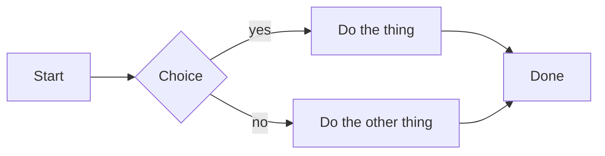
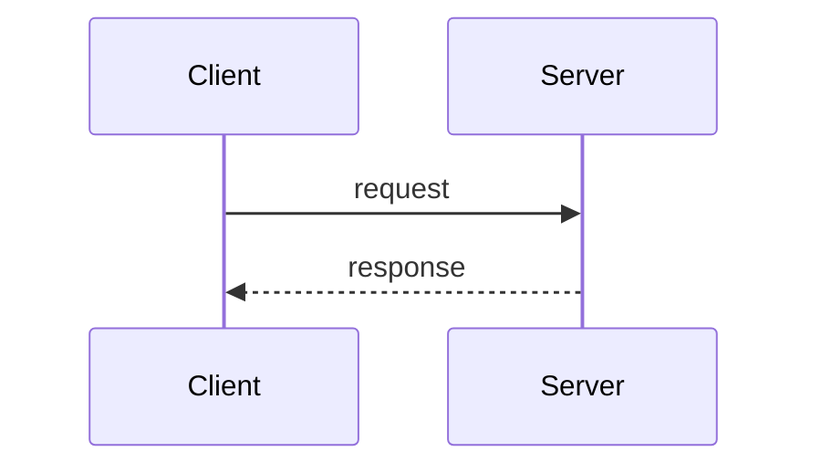
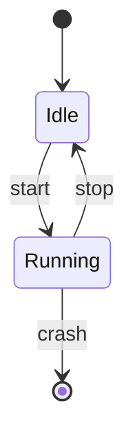
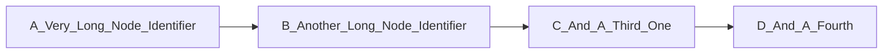
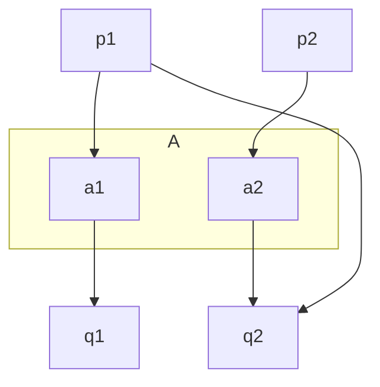
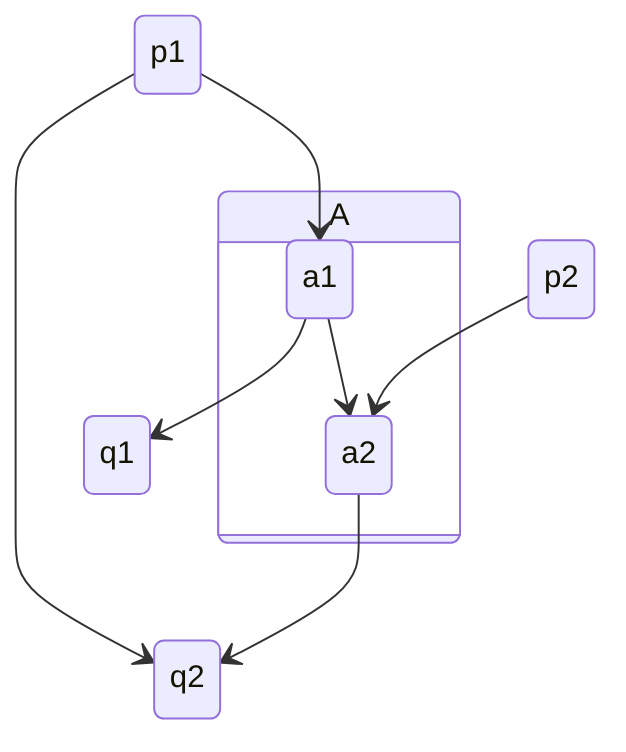

A flowchart:



A sequence diagram:



A state diagram:



A diagram whose natural layout is wider than the corpus width. The layout
backend treats the width as a hint, not a clamp, so this one comes back 119
columns wide at any budget. It is still drawn, with its right edge clipped
rather than word-wrapped into confetti: half a row of a diagram is neither the
diagram nor its source, while a clipped row still reads as the shape it came
from:



A fence that is not a diagram at all, which must fall back to its source:

```mermaid
this is not a diagram
```

Two diagrams that reach a tie in the layout engine's block ordering, and so
pin the vendored `ascii-dag` fix (see `crates/ascii-dag/VENDORED.md`). A
subgraph's nodes are grouped into blocks, and the blocks are ordered by their
members' average position; when two blocks tie, an unfixed engine resolves the
tie from `HashMap` iteration and lays the diagram out differently from one
process to the next. Both diagrams below tie, so a regression here is a
flapping snapshot rather than a stable wrong picture:

A flowchart whose subgraph members share a level with an unaffiliated edge
dummy, tying the subgraph's block against the unaffiliated one:



A state diagram whose composite state — a subgraph too — ties the same way:


