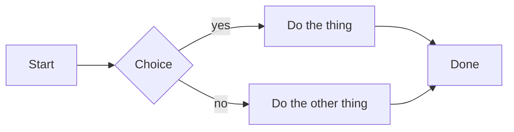
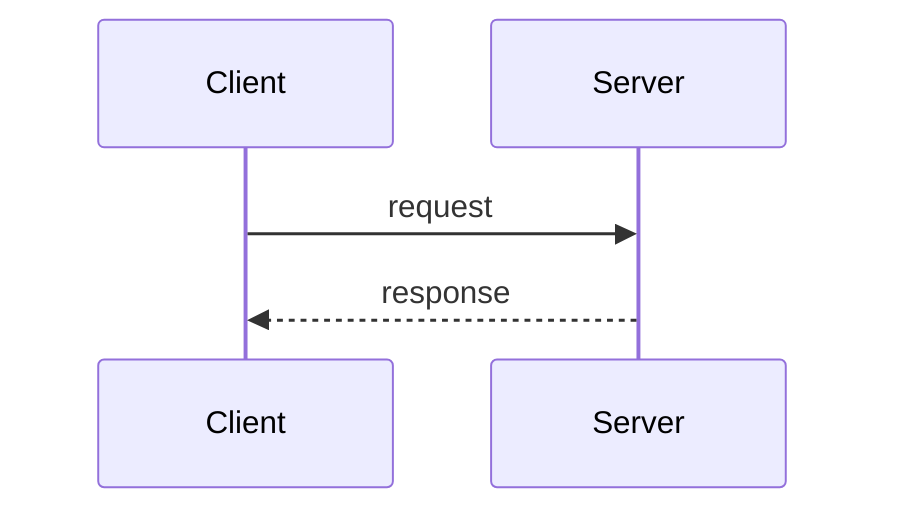
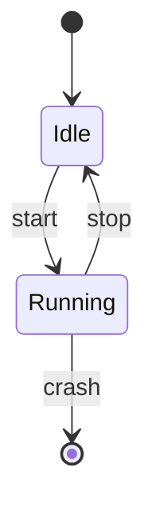
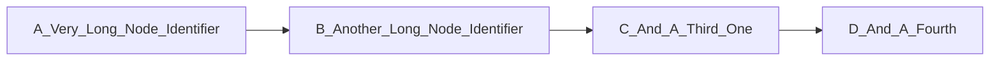

A flowchart:



A sequence diagram:



A state diagram:



A diagram whose natural layout is wider than the corpus width. The layout
backend treats the width as a hint, not a clamp, so this one comes back 119
columns wide at any budget and must fall back to its source rather than being
word-wrapped into confetti:



A fence that is not a diagram at all, which must fall back to its source:

```mermaid
this is not a diagram
```
