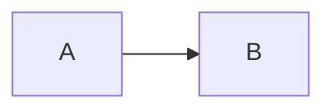

# Title

First paragraph with **bold** and `code`.

- item one
  - nested item

| a | b |
| - | - |
| 1 | 2 |

```rust
fn main() {}
```

## Tail

The tail exists so that the document is taller than a window, which is what
makes a scroll position something that can be lost and restored. Everything
above this heading has to keep its line number, because the cursor-mapping
checks name those lines.

- tail item 1
- tail item 2
- tail item 3
- tail item 4
- tail item 5
- tail item 6
- tail item 7
- tail item 8

A paragraph between the lists, long enough to wrap at a narrow width and so
exercise the wrapping path alongside everything else.

- tail item 9
- tail item 10
- tail item 11
- tail item 12
- tail item 13
- tail item 14
- tail item 15
- tail item 16

> A block quote in the tail, so the document is not all lists.

Another paragraph. It is here to push the document past the height of the
window, and it says nothing in particular.

- tail item 17
- tail item 18
- tail item 19
- tail item 20
- tail item 21
- tail item 22
- tail item 23
- tail item 24

### Deeper

One last heading and a last paragraph, so that the end of the document is a
few lines below the point the scroll checks move to.


