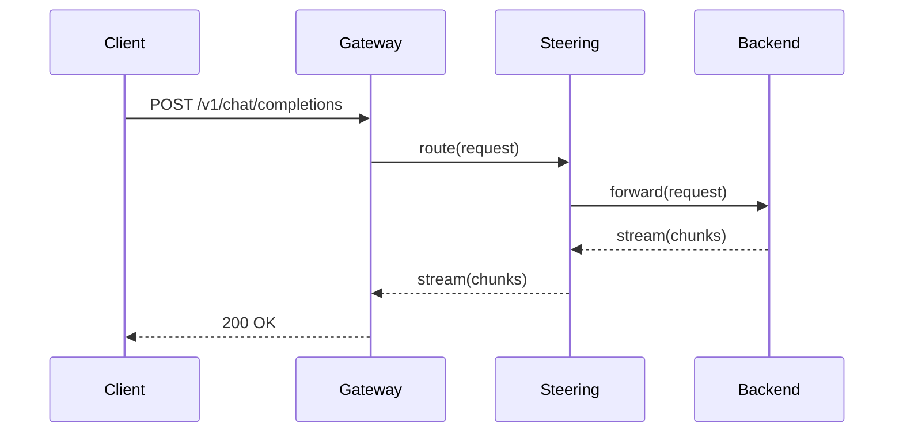

# Wide diagram

One diagram, wider than the preview popup as well as wider than a narrow window.

It is a fixture of its own rather than a second fence in `wide.md` because the
window's own rendering is what the preview checks compare against, and a diagram
that the window clips to its full width would move that measurement for the
table. Keeping the block alone keeps the comparison about one block.

