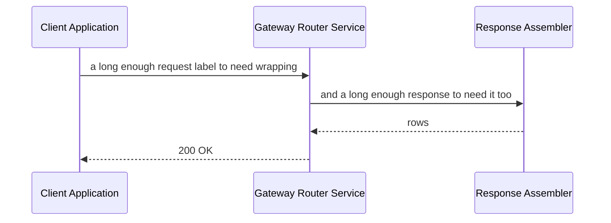

# Zoom diagram

One diagram, wider than the preview popup's own inner width at a narrow
terminal, and narrow enough that the engine can lay it out whole inside that
width by wrapping its labels.

It is the other half of the pair with `wide-diagram.md`. That fixture's diagram
is also wider than the popup, but it cannot be laid out whole any narrower than
108 columns, so zooming it out lands on that floor rather than on the popup. This
one compacts to 69 at a 70-column budget (36 rows, against 40 for the narrower
64-column arrangement the old search stopped at), so zooming it out lands on the
popup itself and the diagram is reachable without scrolling sideways.

